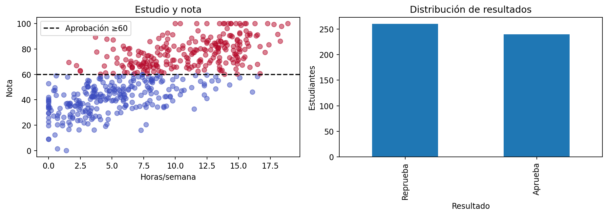
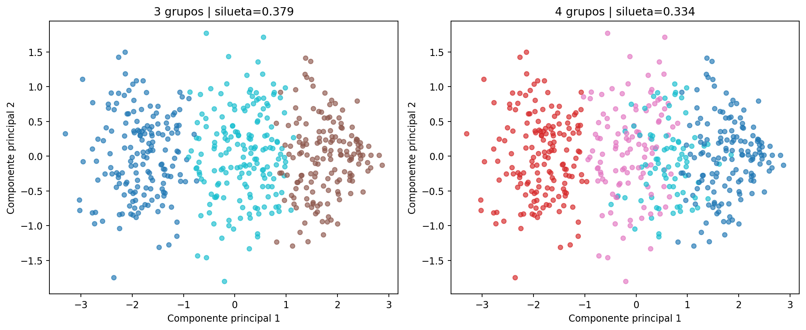
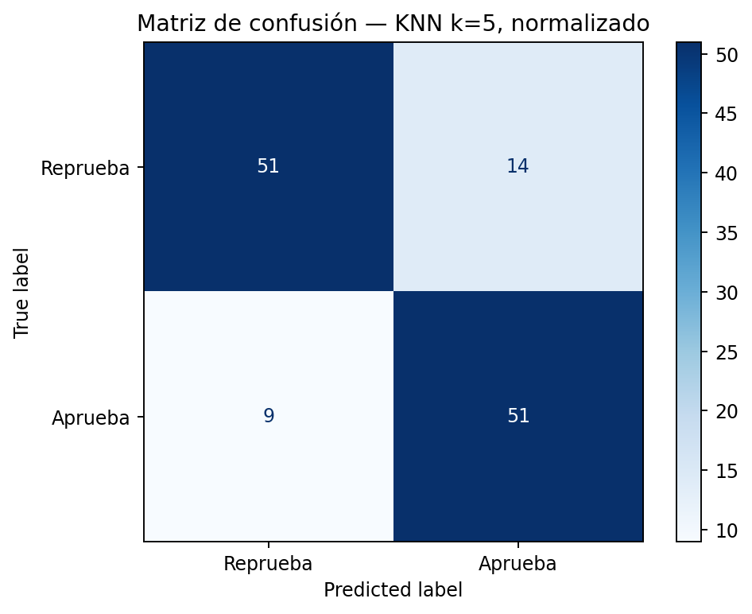
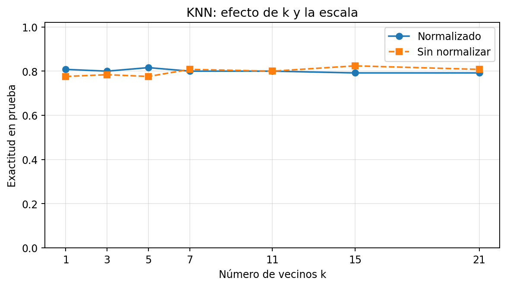

# 📕 Academic Habits | K-Means & KNN

**Machine Learning & Student Performance Analysis | Python**

An academic Machine Learning project that explores study habits across 500 **synthetically generated** student records, identifies behavioral groups with K-Means, and predicts pass/fail outcomes using K-Nearest Neighbors (KNN).

---

## About the Project

The project studies relationships between weekly study hours, attendance, assignment completion, and academic performance. It compares K-Means clustering with three and four groups, then evaluates a KNN classifier on a held-out test set.

**Important:** The dataset is simulated for educational purposes. The results should not be used to make decisions about real students.

## Project Goals

- Explore student study habits and academic outcomes.
- Identify behavioral profiles using K-Means clustering.
- Compare three- and four-cluster solutions using silhouette scores.
- Predict pass/fail outcomes with KNN.
- Evaluate classification performance and compare different values of `k`.
- Examine the effect of feature scaling on nearest-neighbor classification.
- Visualize the results and discuss methodological limitations.

## Technologies Used

| Technology | Purpose |
|---|---|
| Python | Data analysis and modeling |
| NumPy | Synthetic data generation |
| Pandas | Data preparation and exploration |
| Scikit-learn | K-Means, KNN, PCA, scaling and evaluation |
| Matplotlib | Data visualizations |
| Jupyter Notebook | Step-by-step analysis |

## Features

- **Synthetic Dataset:** 500 reproducible observations with five original fields.
- **Exploratory Analysis:** Distributions of grades and pass/fail outcomes.
- **K-Means Clustering:** Comparison of `k=3` and `k=4` using standardized features.
- **PCA Visualization:** Two-dimensional projection for displaying clusters.
- **KNN Classification:** A `k=5` baseline using a stratified 75/25 split.
- **Model Evaluation:** Accuracy, classification report and confusion matrix.
- **KNN Experimentation:** Comparison of `k = 1, 3, 5, 7, 11, 15, 21` with and without normalization.
- **Example Prediction:** Classifies a hypothetical student's academic outcome.

## How It Works

**1. Data Generation**  
Generate 500 student records using a fixed random seed. The variables include study hours, attendance percentage, assignment completion percentage, grade, and result.

**2. Exploratory Analysis**  
Review summary statistics and visualize the relationship between study hours and grades.

**3. K-Means Clustering**  
Standardize the three study-habit features, compare three versus four groups, and assess silhouette scores.

**4. KNN Classification**  
Split the dataset into training (375 records) and testing (125 records). Use a scaling/classification pipeline to avoid fitting the scaler on test data.

**5. Experimentation**  
Compare several neighbor counts and scaled versus unscaled features using the same test split.

**6. Prediction**  
Classify a sample student based on study hours, attendance, and assignment completion.

## Results

The notebook reports the following results for its fixed synthetic dataset:

| Evaluation | Reported result |
|---|---:|
| K-Means silhouette, 3 groups | 0.379 |
| K-Means silhouette, 4 groups | 0.334 |
| KNN accuracy, `k=5` (scaled) | 81.6% |
| KNN accuracy, `k=5` (unscaled) | 77.6% |
| Training / test observations | 375 / 125 |

Results are specific to the generated dataset. The notebook also notes that tuning `k` on the test set and reporting the same test score as final performance can be optimistic.

## Preview

### Study Habits and Grades



### K-Means Clustering



### KNN Confusion Matrix



### KNN: Effect of Scaling and Neighbors



## Running the Project

### Requirements

- Python 3.11+ with compatible library versions
- Jupyter Notebook, JupyterLab, VS Code, or Google Colab

### Installation

```bash
git clone https://github.com/USERNAME/Academic-Habits-KMeans-KNN.git
cd Academic-Habits-KMeans-KNN
python -m venv .venv
```

On Windows PowerShell, you can install packages into the environment without activating it:

```powershell
.\.venv\Scripts\python.exe -m pip install -r requirements.txt
```

Open `academic_habits_kmeans_knn.ipynb` in your notebook environment and run all cells in order.

Alternatively, upload the `.ipynb` file to Google Colab and run its cells.

## Project Structure

```text
Academic-Habits-KMeans-KNN/
├── academic_habits_kmeans_knn.ipynb
├── estudiantes_500.csv
├── requirements.txt
├── visualizations/
│   ├── 01-exploratory-analysis.png
│   ├── 02-kmeans-clusters.png
│   ├── 03-knn-confusion-matrix.png
│   └── 04-knn-comparison.png
├── .gitignore
└── README.md
```

## Limitations

- All student observations and outcomes are simulated, not real-world academic data.
- Clustering groups are descriptive and do not prove causal relationships.
- The KNN outcome is not suitable for real student assessment.
- Model-selection comparisons use the test split for exploration; a separate validation strategy would be needed for rigorous final performance estimates.

## Authors

- **Author:** Walter Santos
- **Co-Author:** Patricia Alvarado

---

**Academic Habits** · K-Means · KNN · Machine Learning · Python

*¡Supérate! Fundación Frech.*
